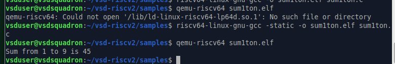
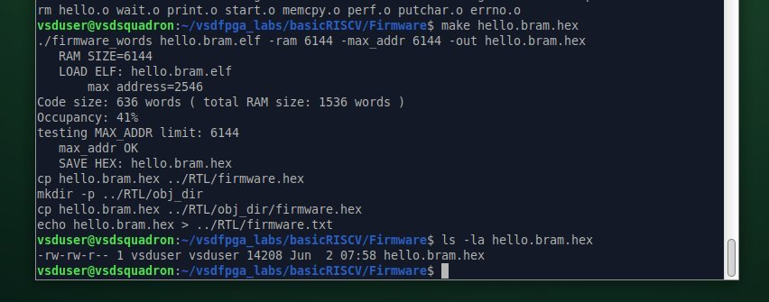
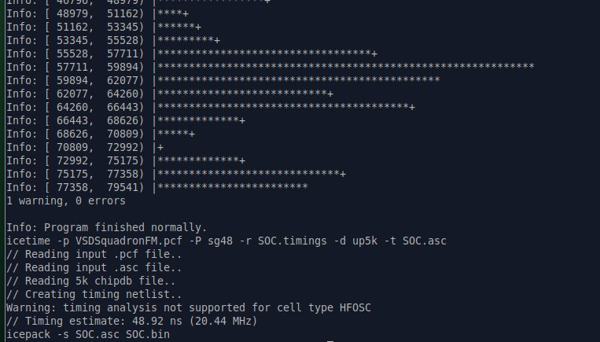

# Task-1: Environment Setup & RISC-V Reference Bring-Up

**Author:** Vivek Sudam Kurle
**Environment used:** GitHub Codespace + local setup (Ubuntu / Xubuntu VM in VirtualBox)

## Objective
Set up the toolchain, run the RISC-V reference program from `vsd-riscv2`, and build the `vsdfpga_labs` basic lab, as a common baseline for later IP and FPGA tasks.

## Repositories
- https://github.com/vsdip/vsd-riscv2
- https://github.com/vsdip/vsdfpga_labs

## Step 1: Codespace
Forked `vsd-riscv2`, launched a Codespace from the fork, and confirmed it built and opened without errors.

## Step 2: RISC-V reference flow (local Ubuntu)
```bash
git clone https://github.com/vsdip/vsd-riscv2.git
cd vsd-riscv2/samples
sudo apt install -y gcc-riscv64-unknown-elf binutils-riscv64-unknown-elf
riscv64-unknown-elf-gcc --version        # GCC 13.2.0
```
- `make hello-spike` and the bare-metal `picolibc` build failed on this Ubuntu install (no `crt0.o` / `stdout` for the bare-metal toolchain).
- Workaround: compile with the Linux cross compiler and run on QEMU user mode:
```bash
sudo apt install -y gcc-riscv64-linux-gnu qemu-user
riscv64-linux-gnu-gcc -static -o sum1ton.elf sum1ton.c
qemu-riscv64 sum1ton.elf
```
- Also built Spike (`riscv-isa-sim`) and the proxy kernel (`riscv-pk`) from source and ran:
```bash
spike /usr/local/riscv64-linux-gnu/bin/pk /home/vsduser/vsd-riscv2/samples/sum1ton.elf
```

**Output:**
```
Sum from 1 to 9 is 45
```
Disassembly of `hello.elf` (`riscv64-unknown-elf-objdump -d`) showed `li a5,42` for `volatile int x = 42`, confirming the toolchain targets RISC-V correctly.



## Step 3: VSDFPGA labs (`vsdfpga_labs`)
```bash
git clone https://github.com/vsdip/vsdfpga_labs.git
cd vsdfpga_labs/basicRISCV/Firmware
make hello.bram.elf
make hello.bram.hex
```
Result: `hello.bram.hex` generated. RAM size 6144, code size 636 words, occupancy 41%, max address OK. The hex was copied to `../RTL/firmware.hex`.

Then in `RTL/`:
```bash
make
```
Yosys → nextpnr → icetime → icepack completed with 0 errors. Timing estimate 48.92 ns (20.44 MHz). Generated `SOC.asc` and `SOC.bin` (104090 bytes).




## Step 4: Local machine preparation
Both repositories were cloned locally and the tools were installed natively on Ubuntu using the Dockerfile as a reference: RISC-V GCC (`riscv64-unknown-elf-gcc`), Yosys, nextpnr-ice40, Project IceStorm (`icepack`, `icetime`, `iceprog`), Icarus Verilog and picocom.

## Understanding Check

**1. Where is the RISC-V program located in `vsd-riscv2`?**
In `samples/`: `sum1ton.c`, `1ton_custom.c` (C calling an assembly routine), `load.S` (assembly `load` function) and the `Makefile`.

**2. How is the program compiled and loaded into memory?**
It is compiled with `riscv64-unknown-elf-gcc`. In `vsdfpga_labs/basicRISCV/Firmware`, the Makefile assembles/compiles for `rv32i` / `ilp32`, links with `bram.ld` into `*.bram.elf`, and `firmware_words` converts the ELF to `*.bram.hex`. The hex is copied to `RTL/firmware.hex`, which initializes the on-chip BRAM that holds code and data when the SoC is built and flashed.

**3. How does the core access memory and memory-mapped IO?**
Through the `mem_addr`, `mem_rdata`, `mem_rstrb`, `mem_wdata` and `mem_wmask` signals. In `riscv.v`, `isIO = mem_addr[22]` selects the IO page, otherwise the access goes to RAM. Inside the IO page, addressing is one-hot on the word address: `IO_LEDS_bit = 0`, `IO_UART_DAT_bit = 1`, `IO_UART_CNTL_bit = 2`. Writes use `mem_wstrb`; `mem_rdata` is muxed between `RAM_rdata` and `IO_rdata`.

**4. Where would a new FPGA IP block logically integrate?**
In `riscv.v` in the IO section next to the LEDs and UART: add a new one-hot IO bit (the next free one, bit 3), generate its select as `isIO & mem_wstrb & mem_wordaddr[NEW_BIT]`, instantiate the IP there, and add its read data to the `IO_rdata` mux. For an IP with several registers, also qualify the IP's own `valid` with `mem_wordaddr[BIT]`; leaving it as just `isIO` makes the IP react to writes meant for other peripherals (this was the Task-2 bug).
