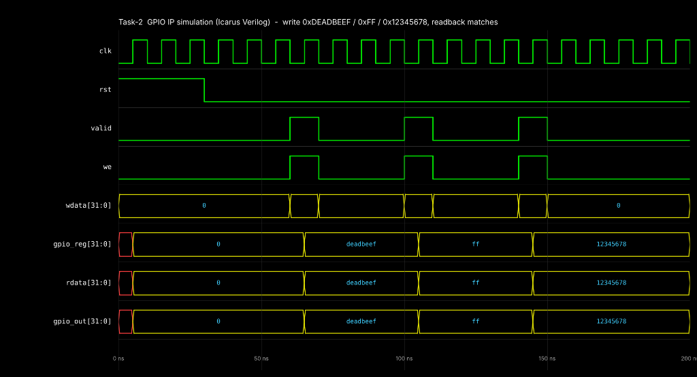

# Task-2: Design & Integrate Your First Memory-Mapped IP

**Internship:** VSDSquadron FPGA Mini  
**Tools:** GitHub Codespaces, Icarus Verilog, RISC-V GCC (`riscv64-unknown-elf-gcc`)

## Objective
Design a 32-bit memory-mapped GPIO output register, integrate it into the FemtoRV32 SoC, and prove from C code that the CPU can write a value and read it back.

## Address Map

| Word bit | Peripheral | Byte address | Access |
|----------|-----------|--------------|--------|
| 0 | LEDs | `0x400004` | Write |
| 1 | UART data | `0x400008` | Write |
| 2 | UART status | `0x400010` | Read |
| **3** | **GPIO** | **`0x400020`** | **Read/Write** |

The SoC uses one-hot word addressing in the IO page:
```
isIO       = mem_addr[22]      -> 0x400000
GPIO select = mem_wordaddr[3]   -> word bit 3 = byte offset 0x20
GPIO_BASE                       =  0x400020
```
Word bit N corresponds to byte offset `4 << N`, so bit 3 is `0x20`. (`(3 << 2)` would set word bits 0 and 1, which are the LED and UART registers.)

## Step 1 — Understand the SoC
```verilog
wire isIO  = mem_addr[22];          // 1 = peripheral, 0 = RAM
wire isRAM = !isIO;
assign mem_rdata = isRAM ? RAM_rdata : IO_rdata;
```
A peripheral write looks like the existing LED logic:
```verilog
if (isIO & mem_wstrb & mem_wordaddr[IO_LEDS_bit]) LEDS <= mem_wdata;
```

## Step 2 — GPIO IP (`gpio_out.v`)
```verilog
module gpio_out (
    input  wire        clk,
    input  wire        rst,
    input  wire        valid,
    input  wire        we,
    input  wire [31:0] wdata,
    output reg  [31:0] rdata,
    output wire [31:0] gpio_out
);
    reg [31:0] gpio_reg;

    always @(posedge clk) begin
        if (rst)                gpio_reg <= 32'h00000000;
        else if (valid && we)   gpio_reg <= wdata;
    end

    always @(*) rdata = gpio_reg;
    assign gpio_out = gpio_reg;
endmodule
```

## Step 3 — SoC integration (`riscv.v`)
```verilog
localparam IO_GPIO_bit = 3;

wire [31:0] gpio_rdata;
wire [31:0] gpio_pins;
gpio_out GPIO(
   .clk(clk),
   .rst(!resetn),
   .valid(isIO & mem_wordaddr[IO_GPIO_bit]),   // GPIO's own address only
   .we(mem_wstrb),
   .wdata(mem_wdata),
   .rdata(gpio_rdata),
   .gpio_out(gpio_pins)
);

wire [31:0] IO_rdata =
    mem_wordaddr[IO_UART_CNTL_bit] ? {22'b0, !uart_ready, 9'b0} :
    mem_wordaddr[IO_GPIO_bit]      ? gpio_rdata                  :
                                     32'b0;
```
**Bug found during bring-up:** with `.valid(isIO)` the register also captured UART and LED writes, so reads returned wrong data. Qualifying `valid` with `mem_wordaddr[IO_GPIO_bit]` fixed it.

## Step 4 — Software validation

`Firmware/gpio_test.c`:
```c
#include <stdio.h>
#include <stdint.h>

#define GPIO_ADDR 0x400020
volatile uint32_t *gpio = (volatile uint32_t *)GPIO_ADDR;

void main() {
    *gpio = 0xDEADBEEF;
    printf("GPIO test 1: %x\n", (unsigned int)*gpio);

    *gpio = 0x000000FF;
    printf("GPIO test 2: %x\n", (unsigned int)*gpio);

    *gpio = 0x12345678;
    printf("GPIO test 3: %x\n", (unsigned int)*gpio);

    printf("ALL TESTS DONE\n");
}
```
> The SoC's `printf` does not support `%08X`; use `%x`.

Build and simulate:
```bash
cd Firmware
make gpio_test.bram.hex          # ~672 words, ~43% of RAM

cd ../RTL
iverilog -o sim_gpio -DBENCH riscv.v gpio_out.v ice40_primitives.v
vvp sim_gpio
```

### Expected result
<!-- VERIFY: re-run at 0x400020 and replace this block with your real output/screenshot -->
```
GPIO test 1: deadbeef
GPIO test 2: ff
GPIO test 3: 12345678
ALL TESTS DONE
```

| Test | Written | Read back | Expected |
|------|---------|-----------|----------|
| 1 | `0xDEADBEEF` | `deadbeef` | Match |
| 2 | `0x000000FF` | `ff` | Match |
| 3 | `0x12345678` | `12345678` | Match |



## Files
| File | Description |
|------|-------------|
| `RTL/gpio_out.v` | GPIO IP (new) |
| `RTL/riscv.v` | SoC top, with GPIO added |
| `RTL/ice40_primitives.v` | Simulation stubs for iCE40 primitives |
| `Firmware/gpio_test.c` | C validation program |

## Limitations
- One 32-bit register, no direction control (added in Task-3).
- `gpio_out` is not connected to FPGA pads; it is checked through software readback.

## What I learned
- A memory-mapped peripheral is just a register the CPU reaches through load/store.
- One-hot decoding means the address bit chosen in `riscv.v` decides the byte address (`4 << bit`).
- Every IP needs three pieces of glue: an address bit, an instance with a qualified `valid`, and an entry in the read mux.
