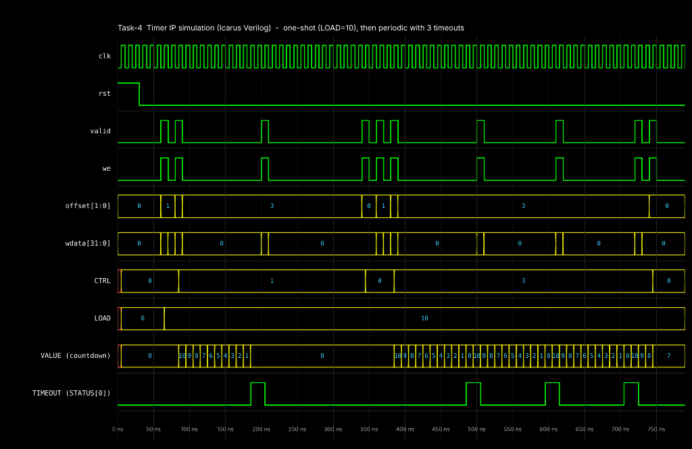
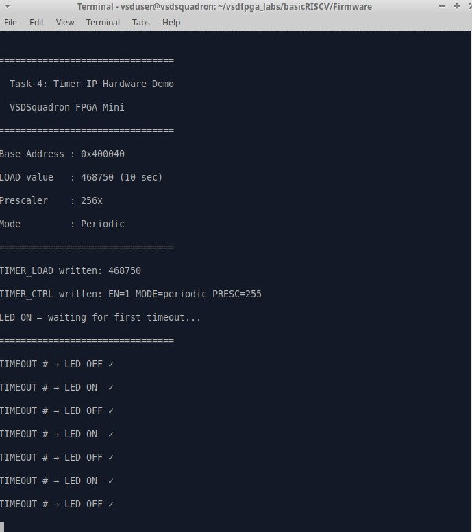
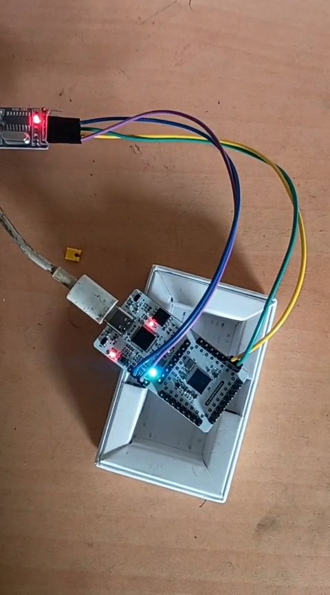

# Task-4: Real Peripheral IP Development — Timer IP

**Assigned IP:** Timer IP (Option 1)  
**Board:** VSDSquadron FPGA Mini (Lattice iCE40 UP5K)  
**IP package:** [`ip/timer_ip`](../ip/timer_ip)

## What was built
A 32-bit memory-mapped countdown timer integrated into the FemtoRV32 SoC: LOAD, CTRL (enable, one-shot/periodic, prescaler), read-only VALUE, and a write-1-to-clear TIMEOUT flag. Base address `0x400040`.

Register map: [Register_Map.md](../ip/timer_ip/docs/Register_Map.md)

## Address decoding
```
isIO = mem_addr[22] = 1        -> 0x400000
mem_wordaddr[4] = mem_addr[6]  -> 0x000040
TIMER_BASE                     =  0x400040
```
An early test used `0x400010`, which hung at "Waiting for TIMEOUT"; this was corrected to `0x400040`.

## SoC integration (riscv.v)
1. `localparam IO_TIMER_bit = 4;`
2. `timer_ip TIMER(... .valid(isIO & mem_wordaddr[IO_TIMER_bit]) ...)`
3. `mem_wordaddr[IO_TIMER_bit] ? timer_rdata` added to the `IO_rdata` mux

## Simulation (Icarus Verilog)
```bash
cd RTL
iverilog -o test_timer -DBENCH riscv.v timer_ip.v gpio_out_v3.v ice40_primitives.v
cd ../Firmware && make timer_test.bram.hex
cd ../RTL && vvp test_timer
```
Output:
```
=== Test 1: One-shot mode ===
Timer started. Load=100
Waiting for TIMEOUT...
TIMEOUT! VALUE=0
TIMEOUT cleared. STATUS=0

=== Test 2: Periodic mode (3 timeouts) ===
Timeout #1! VALUE=36
Timeout #2! VALUE=39
Timeout #3! VALUE=42

ALL TESTS DONE
```
| Check | Result |
|-------|--------|
| One-shot reaches 0 and sets TIMEOUT | Pass |
| Write-1-to-clear | Pass |
| Periodic auto-reload, 3 timeouts without CPU restart | Pass |



## Hardware validation
Firmware: [`timer_blink.c`](../ip/timer_ip/software/timer_blink.c)

```bash
cd Firmware && make timer_blink.bram.hex
cp timer_blink.bram.hex ../RTL/firmware.hex
echo timer_blink.bram.hex > ../RTL/firmware.txt
cd ../RTL && make build && make flash
picocom -b 9600 /dev/ttyUSB0 --imap lfcrlf,crcrlf --omap delbs,crlf
```

| Time | On-board behaviour |
|------|--------------------|
| 0 s | RGB LED WHITE; Timer IP counting 468,750 ticks (10 s at 12 MHz / 256) |
| 10 s | TIMEOUT: CPU detects flag, clears it, LED switches to CYAN blink |
| after blink | All LEDs off for 5 s, then the 10 s cycle repeats |

LOAD calculation: `12,000,000 / 256 = 46,875 ticks/s`, so 10 s = `46,875 × 10 = 468,750`.




**Demo video:** *(add your Google Drive / YouTube link here)*

### Honest scope notes
- The auto-reload (periodic, MODE=1) behaviour is verified in **simulation**. In the hardware demo the CPU re-arms the timer in one-shot mode each cycle so that the single timer stays dedicated to the 10 s countdown.
- Blink and pause delays in the demo use calibrated software loops, not the Timer IP.
- To get the on-board LED working, the SoC drives it through `SB_RGBA_DRV`, and the reset input is tied low (the board RESET button is therefore inactive). See the [Integration Guide](../ip/timer_ip/docs/Integration_Guide.md).

## Issues found and fixed
| Issue | Fix |
|-------|-----|
| Simulation stuck waiting for TIMEOUT | Wrong base address, corrected to `0x400040` |
| Yosys "multiple conflicting drivers" on status flag | Merged into one clocked block with `timeout_flag` |
| CPU never ran on the board | Floating reset pin; tied `Clockworks.RESET` to `1'b0` |
| LEDs not responding | RGB LED needs `SB_RGBA_DRV`; raised current to `0b111111` |
| No UART output | UART bit 9 is *busy*; wait with `while (UART_CNTL & (1<<9))` |
| Old behaviour after rebuild | Hex must be copied before `make build` (embedded at synthesis) |
| Build failed with disk errors | Removed 647 MB simulation `.vcd` |
